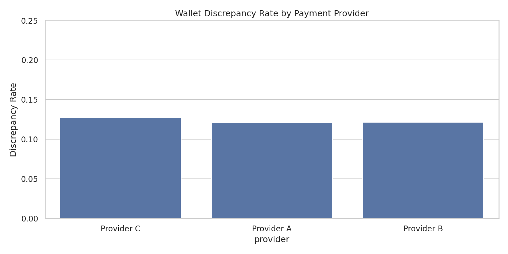
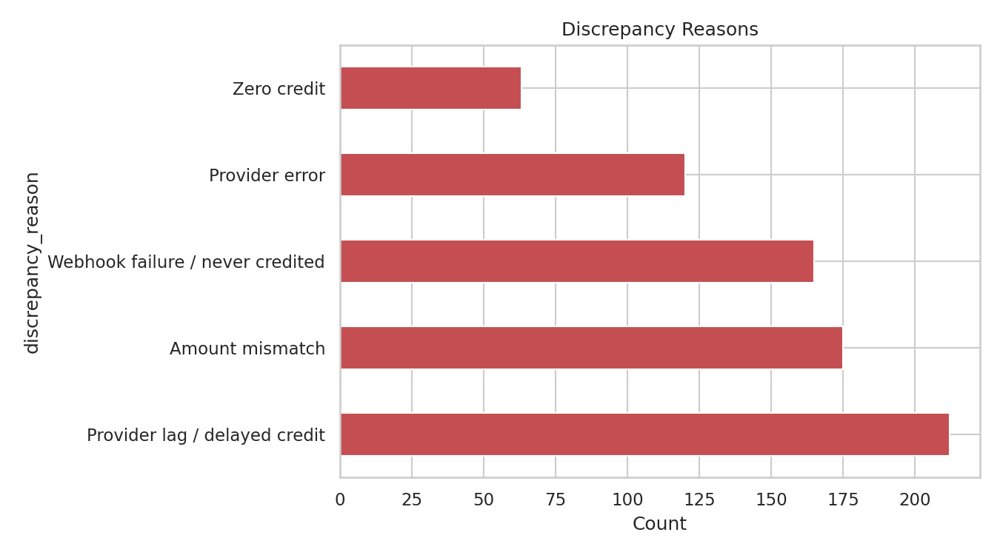
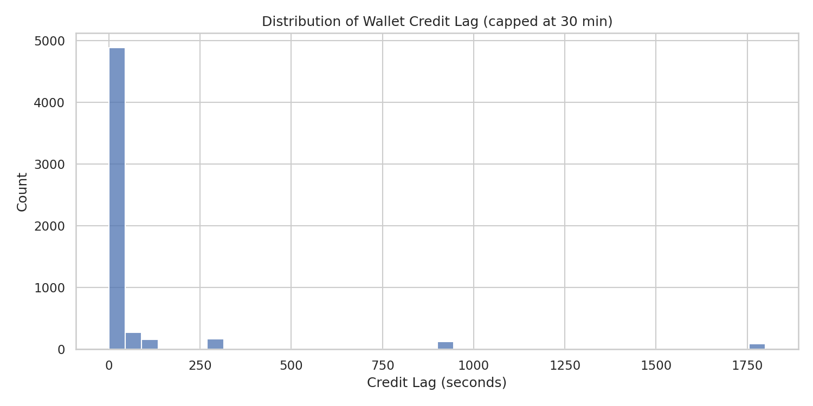
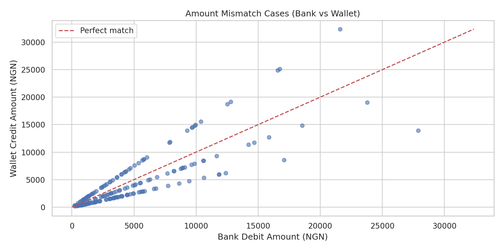

# Wallet Reconciliation & Discrepancy Pipeline

**Author:** [Omololu Oyewumi](https://www.linkedin.com/in/omololu-oyewumi-4aa682331)  
**Stack:** Python · Pandas · Matplotlib · Seaborn

---

## Problem Statement

One of the most common (and time-consuming) issues in fintech support is the mismatch between a bank debit and a wallet credit. A customer is charged by their bank, but the money never appears in their wallet — or appears late, or appears with the wrong amount.  

Support agents currently investigate these cases manually, ticket by ticket. This project shows how the same work can be automated: flag discrepancies, classify the root cause, and surface which providers drive the bulk of the problems.

**No real customer or company data was used.** All data is synthetic.

---

## Overview

- **6,000** synthetic bank-debit / wallet-credit pairs over ~60 days  
- Overall discrepancy rate: **12.2%**  
- Root causes tracked: provider lag, amount mismatch, webhook failure, zero credit, provider error

---

## Key Findings

| Reason | Count | Notes |
|--------|-------|-------|
| Provider lag / delayed credit | 212 | Credit took > 5 minutes |
| Amount mismatch | 175 | Wallet credited wrong amount |
| Webhook failure / never credited | 165 | Bank debited, wallet never updated |
| Provider error | 120 | Explicit provider-side failure |
| Zero credit | 63 | Wallet received ₦0 |

Provider discrepancy rates are broadly similar (~12%), with Provider C slightly higher.

### Discrepancy Rate by Provider


### Discrepancy Reasons


### Credit Lag Distribution


### Amount Mismatch Cases


---

## Business Value

This pipeline essentially automates the manual reconciliation work that support teams currently do by hand:

- Instantly flag mismatches  
- Show which provider / reason is driving volume  
- Give ops a daily “discrepancy dashboard” instead of reactive, ticket-by-ticket digging  

---

## How to Run the Dashboard

```bash
# Install dependencies
pip install -r ../requirements.txt

# Launch the interactive dashboard
streamlit run app.py
```

The dashboard opens in your browser with KPIs, filters and interactive charts on one page.

### Optional: Regenerate data / static charts
```bash
python scripts/generate_data.py
python scripts/analyze.py
```


## Tech Stack

Python, Pandas, NumPy, Matplotlib, Seaborn, Faker

## Project Structure
```
├── app.py                          ← Streamlit dashboard (main entry)
├── data/
│   └── wallet_discrepancies.csv
├── scripts/
│   ├── generate_data.py
│   └── analyze.py
├── outputs/
│   ├── discrepancy_by_provider.png
│   ├── discrepancy_reasons.png
│   ├── credit_lag_distribution.png
│   ├── amount_mismatch_scatter.png
│   └── insights_summary.txt
└── README.md
```

---

## Disclaimer

**Important:** All figures are from synthetic data generated to demonstrate analytical methodology and dashboard design. They do **not** represent real-world performance of any payment provider or platform.

Provider names are fictional (Provider A / B / C). No real payment provider performance is implied. Patterns were parameterized to fall within realistic operational ranges for illustration purposes only.

---

**Connect with me:** [LinkedIn](https://www.linkedin.com/in/omololu-oyewumi-4aa682331)
